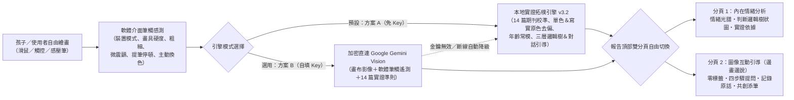

# 心畫室 MindCanvas v3.2 — 操作標準作業程序（SOP）

> **線上互動網頁（GitHub Pages）**：https://cpj0624.github.io/mindcanvas-drawing-psychology/  
> **GitHub 專案儲存庫**：https://github.com/cpj0624/mindcanvas-drawing-psychology  
> **Google Drive 專案資料夾**：`反重力 / 心畫室_MindCanvas_兒童心理學繪畫探索/`

---

## 一、系統雙方向分頁與雙引擎總覽（v3.2）

心畫室 v3.2 在 **方案 A（本地引擎）** 與 **方案 B（Gemini 視覺模式）** 上皆同步導入 **14 篇國際心理學同儕審查期刊實證研究**、**軟體介面筆觸感測**與**雙方向分頁報告**。每次按下「解析畫作與互動引導」後，系統會同時產出兩種視角，使用者可於報告頂部分頁自由切換：

- **分頁 1｜內在情緒分析**（給大人／助人者檢視）：六大情緒光譜、互動式三層判斷邏輯樹狀圖、Pénzes 正向內在資源、四大實證分頁與防過度解讀護欄。
- **分頁 2｜圖像互動引導（邊畫邊說）**（**零情緒標籤・可與孩子並肩共看**）：隱藏所有分數與情緒分類，純粹依據畫作內容與年齡組提供溫暖開場白、四步驟可勾選對話提問、孩子原話記錄欄、一起多畫一筆共創延伸，以及「避免這樣問 ✕ → 改問 ✓」非誘導提問小抄。

| 比較面向 | 方案 A：本地實證與介面筆觸引擎（預設） | 方案 B：Gemini 實證視覺模式（選用） |
| --- | --- | --- |
| **適用情境** | 一般日常測試、課堂體驗、單色鉛筆素描、重視 100% 離機隱私 | 複雜故事情境畫、特定動物／怪物、多人物互動關係、依具體故事量身設計對話問題 |
| **期刊實證依據** | 完整內建 14 篇國際期刊實證演算法與多證據護欄 | Prompt 完整嵌入同一套 14 篇實證準則＋融合軟體介面筆觸遙測 |
| **雙分頁支援** | 同步產出「內在情緒分析」＋「圖像互動引導」 | 同步產出「內在情緒分析（含 AI 視覺推理樹）」＋「依實景物件客製的圖像互動引導」 |
| **是否需要 API Key** | **不需要**（完全免費） | 需使用者自行填入個人免費 Gemini API Key（BYOK） |
| **資料隱私** | 畫作 100% 留在瀏覽器本地運算，不外傳 | 僅按下分析時將畫布 PNG 與客觀行為數據加密直連 Google 官方 API |
| **分析速度** | `< 0.1 秒` 即時完成 | 約 `2 – 5 秒` |

---

## 二、軟體繪畫介面筆觸感測運作說明

系統會自動偵測您的繪畫裝置，並結合「硬體 Pointer Events」與「軟體介面主動設定」判斷筆觸：

| 裝置類型 | 畫布右下角顯示 | 系統判斷筆觸力道與張力的方式 |
| --- | --- | --- |
| **感壓觸控筆（Apple Pencil / Wacom / Surface Pen）** | `感壓筆真壓感測` | 讀取硬體真實壓力 `pressure`（0–1）與筆身傾斜角 `tiltX / tiltY`，搭配畫具硬度與粗細。 |
| **平板／手機手指觸控** | `觸控接觸面積感測` | 讀取手指接觸面寬度 `width`、劃動速度、畫具硬度與重疊塗抹密度。 |
| **一般滑鼠／筆電觸控板** | `滑鼠介面＋擬真筆壓` | **自動捨棄滑鼠恆定 0.5 假筆壓**，改以**畫具硬度（麥克筆＞蠟筆＞鉛筆＞水彩）× 筆刷粗細 × 劃速 × 重疊塗抹**計算等效筆力，並加上高頻採樣 `getCoalescedEvents` 的**線條微震顫（Jitter）**與**提筆停頓佔比**。 |

- **`擬真筆壓` 按鈕（工具列預設開啟）**：使用滑鼠繪畫時，放慢運筆筆畫會較厚實、快速揮動則呈現自然收細；若想使用固定等寬線條，可隨時點擊工具列的 **`擬真筆壓`** 關閉（不影響底層真實裝置判別）。
- **主動介面操作紀錄**：系統會區分「從頭到尾使用預設黑筆未換色（`換色 0 次`）」與「刻意切換畫具、顏色與粗細」，強化單色去偏準確度。

---

## 三、方案 A 標準操作流程（免設定・日常預設模式）

### 步驟 1：開啟網頁並確認引擎狀態
1. 使用任一現代瀏覽器（Chrome、Safari、Edge）開啟：https://cpj0624.github.io/mindcanvas-drawing-psychology/
2. 確認右上角狀態鈕顯示 **`本地實證引擎 A`**（預設即為此模式）。

### 步驟 2：挑選畫具、年齡常模與自由繪畫
1. **選擇筆刷與擬真筆壓**：可選擇 `蠟筆`、`鉛筆`（單色素描推薦）、`水彩`、`麥克筆` 或 `橡皮擦`，切換 4 段粗細、3 種畫紙底色與 `擬真筆壓`。
2. **選填年齡常模（畫布下方右側）**：可選 `未指定（通用）`、`3–6 歲（學齡前）`、`7–10 歲（國小中低）`、`11 歲以上（高年級／成人）`。年齡常模會同時調整兩套分頁：在「內在情緒分析」中依 Picard & Gauthier (2012) 降低 3–6 歲省略細節的誤判；在「圖像互動引導」中自動切換對應年齡的對話口吻。
3. **自由創作或試玩實證範例**：
   - 可直接以預設炭墨黑作畫（自動啟動單色去偏），或畫出藍天、綠草與暖陽（自動啟動 Crawford 2012「寫實原色去偏」，不會因藍色誤判悲傷）。
   - 點擊右上角 **`心理範例畫作`** 可一鍵體驗 `黑筆笑臉與太陽（單色）`、`藍天綠地暖陽（寫實原色）`、`暖黃筆哭泣落淚臉` 等 9 組範例。

### 步驟 3：（選填）「邊畫邊說」補充心裡話或元素標籤
- 依 Gross & Hayne (1998) 實驗，讓創作者為畫取名字或寫一句心裡話能讓真實情緒表達更完整（留空完全不影響分析；亦可先於「圖像互動引導」分頁聊天記錄孩子原話後，再一鍵回填重新解析）。

### 步驟 4：點擊「解析畫作與互動引導」並自由切換雙分頁
系統一次完成兩大方向分析，您可隨時於報告頂部切換想看的分頁：

#### 視角 A：切換至「內在情緒分析」分頁（建議大人／教師參考）
1. **頂部摘要卡與實證標籤**：顯示**多維證據收斂等級**（`高收斂`／`中度收斂`／`低線索`；若僅畫 1–2 筆簡單線條自動壓低上限至 `<= 66` 分）、`單色鉛筆去偏`、`寫實原色去偏`、年齡常模與偵測到的**表達通道**。
2. **互動式判斷邏輯與依據樹狀圖（可逐層展開）**：
   - 頂部根節點直接總結「為何得出主要情緒、與次高情緒差距及核心依據」。
   - 點擊 5 大分支方向（`① 圖像內容與表情`、`② 軟體介面筆觸`、`③ 空間構圖與尺寸`、`④ 色彩去偏`、`⑤ 口語、年齡常模與護欄`）可逐層展開細項數據、規則與國際期刊依據，支援一鍵「全部展開／全部收合」。
3. **形式結構與內在正向資源卡（Pénzes, 2020）＋多元詮釋提醒（Thomas & Jolley, 1998）**：顯性指出創作者展現的心理彈性與自我整理資源，並提供非情緒成因的溫和替代可能。
4. **四大證據子分頁**：切換 `圖形象徵`、`構圖空間`、`介面筆觸`（6 項介面動力指標）與 `色彩輔助`。

#### 視角 B：切換至「圖像互動引導（邊畫邊說）」分頁（零標籤・可與孩子共看）
1. **兒童共看保護模式**：切換至此分頁時，畫面**完全不顯示情緒分數、六大情緒標籤、畫布偵測框與情緒足跡條**，避免對孩子造成被貼標籤的壓力。
2. **溫暖開場白與分齡陪伴提醒**：直接提供可照著唸給孩子聽的第一句好奇開場白，以及依所選年齡組調整的互動姿態建議。
3. **四步驟互動式提問卡**（① 看見畫面 → ② 走進故事 → ③ 貼近心裡 → ④ 一起共創）：
   - 順著孩子的節奏挑選 1–2 句慢慢聊即可，點擊任一問句即可標記 **`已聊過 ✓`** 並更新右上角進度計數。
4. **記錄孩子說出的心裡話**：
   - 在輸入欄輸入孩子介紹畫作的原話按下 **`記下這句`**（僅存在瀏覽器本次記憶體，重整即清空）。
   - 聊完後可點擊 **`套用孩子原話並重新解析`**，自動將孩子原話寫入「邊畫邊說」欄位並同步更新雙分頁分析！
5. **一起多畫一筆（共創延伸）**：點擊 **`回到畫布一起畫`**，頁面會平滑捲動並提示畫布位置，陪伴孩子添上一筆新夥伴、雨傘或守護道具。
6. **非誘導提問小抄（避免 ✕ → 改問 ✓）**：依本次畫作特徵（如單色黑筆、畫幅較小、反覆修改或留白）量身提醒最容易踩雷的誘導問法與更安全的開放式問法。

### 步驟 5：保存畫作或重新繪製
- 點擊工具列右側 **下載圖示（儲存 PNG）** 可存檔圖片；**重新整理或關閉分頁後所有畫作、孩子原話與足跡紀錄皆自動清除**以保護隱私。

---

## 四、方案 B 進階操作 SOP（啟用 Gemini 實證視覺解讀・BYOK）

> [!IMPORTANT]
> 本網頁程式碼完全不含任何 API Key。此模式採 **BYOK（自備金鑰）** 設計，您輸入的金鑰**僅暫存於瀏覽器單一分頁的 `sessionStorage`**，關閉分頁即自動銷毀，絕不會傳送給 GitHub 或任何第三方伺服器。

### 步驟 1：免費取得個人 Google Gemini API Key（約 1 分鐘）
1. 前往 Google 官方 AI Studio：https://aistudio.google.com/apikey
2. 使用 Google 帳號登入，點擊 **`Create API key`** 建立免費金鑰並複製（格式為 `AIza...`）。

### 步驟 2：在公開瀏覽器安全啟用方案 B
1. **請務必在一般瀏覽器開啟公開 GitHub Pages 網址**（https://cpj0624.github.io/mindcanvas-drawing-psychology/ ）——對話內建預覽沙盒會封鎖外部 API 連線。
2. 點擊右上角 **`本地實證引擎 A`** → 選擇 **`方案 B：Gemini 實證視覺深度解讀（選用・BYOK）`** → 貼上 API Key。
3. 視覺模型維持 **`自動偵測金鑰最新可用模型（推薦）`**，點擊 **`測試金鑰並偵測可用模型`** 確認綠框成功後按下 **`儲存設定`**。

### 步驟 3：AI 雙方向深度解讀與自動降級
- 方案 B 會將畫布影像連同**軟體介面筆觸遙測、年齡常模與 14 篇實證準則**交由 Gemini 綜合判讀，同時強化兩個分頁：
  - 在「內在情緒分析」中辨識自由手繪的動物、人物互動與場景故事，並寫入互動式判斷邏輯樹狀圖；
  - 在「圖像互動引導」中針對畫裡真正畫出的角色與物件量身生成零標籤四步驟提問與共創點子。
- 若金鑰失效、頻率超限或斷線，將自動無縫降級為方案 A。

### 步驟 4：使用完畢清除金鑰（公用電腦必做）
- 點擊右上角 **`Gemini 實證模式 B`** → 按下左下角 **`清除金鑰並切回本地`**（或直接關閉該分頁）。

---

## 五、親子／教師「邊畫邊說」陪伴指引 SOP（Gross & Hayne 1998; Malchiodi 1998）

1. **作畫前（建立安全感）**：強調「沒有畫得像不像或對不對，想畫什麼都可以」，不指導用色或主題。
2. **作畫中（觀察但不打斷）**：不對塗改、畫小或選色下評語，讓創作者自主決定節奏。
3. **作畫後（建議先開「圖像互動引導」分頁與孩子共看）**：
   - 依 Gross & Hayne (1998) 實證，優先從具體畫面出發並透過「聊畫裡的角色」建立安全距離，避免直接逼問「你是不是生氣／被欺負？」。
   - 每次只問 1 題並給足 5–10 秒等待回應；若孩子回答「不知道」，溫柔回應「沒關係，畫出來本身就很棒了」。
   - 對話結束後，大人可單獨切回「內在情緒分析」分頁參考判斷樹狀圖與 **Pénzes 正向內在資源**，**絕不貼臨床診斷標籤**。
   - 若觀察到持續且嚴重的情緒困擾或自傷風險，請聯繫專業諮商／臨床心理師或學校輔導室。

---

## 六、資安與版本維護檢查清單（管理者用）

| 檢查項目 | 標準規範與確認方式 |
| --- | --- |
| **零金鑰外洩檢查** | 公開 GitHub 儲存庫及歷史 commit 絕不可包含 `AIza...`、`sk-...`、`.env` 或明文金鑰；金鑰僅透過 `x-goog-api-key` Header 傳送。 |
| **DOM XSS 與輸入防呆** | 所有動態報告、孩子原話與 AI 文字均經 `escapeHtml()`、`safeCssHex()`、`safeAiText()` 或 `.textContent` 淨化；後端 Pydantic 強制禁止 `NaN/Inf` 並限制點數上限（50,000 點）。 |
| **自動化單元測試** | 執行 `python3 -m unittest discover -s tests -v`，確認 **24 項單元測試**全數通過後再發布。 |
| **雲端同步規範** | 所有專案交付檔統一集中更新於 Google Drive `反重力/心畫室_MindCanvas_兒童心理學繪畫探索/`，不置散檔於根目錄。 |

---

## 七、常見問題排除（FAQ）

- **Q1：可以只拿來陪孩子聊天，不讓孩子看到任何情緒分數嗎？**  
  A：可以！分析完成後點擊報告頂部右側分頁 **`圖像互動引導（邊畫邊說）`**，系統會立即隱藏所有情緒分數、雷達圖、畫布分析框與情緒足跡條，且再次點擊重新解析時會維持停留在互動引導分頁，非常適合與孩子並肩共看。
- **Q2：用一般滑鼠畫畫沒有真實筆壓，系統怎麼判斷筆觸輕重？**  
  A：系統會自動偵測 `pointerType = mouse`，捨棄滑鼠恆定 `0.5` 的假筆壓，改用您選的畫具硬度（麥克筆＞蠟筆＞鉛筆＞水彩）、筆刷粗細、劃動速度、重疊塗抹密度、線條微震顫與提筆停頓佔比綜合推估，並在報告「介面筆觸」分頁誠實標示為「滑鼠／觸控板介面推估」。
- **Q3：我畫了藍天、綠地和黃太陽，為什麼不會因為大面積藍色而被判悲傷？**  
  A：系統依據 Crawford 等人（2012）寫實原色實驗內建「寫實原色去偏」，偵測到藍＋綠／暖黃自然風景組合時會自動降權藍色的負向悲傷分數並顯示 `寫實原色去偏` 標籤。
- **Q4：我只畫了一條線，為什麼分數最高只有 66 分？**  
  A：依 Joiner (1996) 與 Catte & Cox (1999) 實證，單一線條或單一特徵不可直接推論情緒困擾；系統在偵測到「低線索」時會主動調降極端分數上限，避免誤導使用者。
- **Q5：啟用方案 B 時出現 HTTP 400 / 403 / 404 / 429 怎麼辦？**  
  A：`400/401/403` 請回 Google AI Studio 確認金鑰與權限；`404` 請切換為「自動偵測金鑰最新可用模型（推薦）」；`429` 代表免費方案短時間呼叫過快，稍等 1 分鐘即可（期間自動降級回方案 A）。
