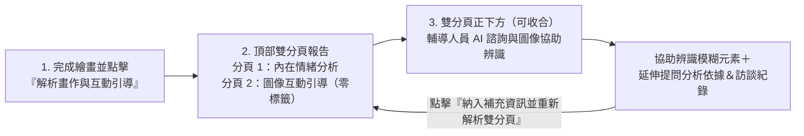

# 心畫室 MindCanvas v3.4 — 操作標準作業程序（SOP）

> **線上互動網頁（GitHub Pages）**：https://cpj0624.github.io/mindcanvas-drawing-psychology/  
> **GitHub 專案儲存庫**：https://github.com/cpj0624/mindcanvas-drawing-psychology  
> **Google Drive 專案資料夾**：`反重力 / 心畫室_MindCanvas_兒童心理學繪畫探索/`

---

## 一、系統雙分頁、輔導員 AI 諮詢與雙引擎總覽（v3.4）

心畫室 v3.4 在 **方案 A（本地引擎）** 與 **方案 B（Gemini 視覺模式）** 上皆同步導入 **7 大類別共 24 篇國際心理學同儕審查期刊實證研究（以純圖像涵義為主而非色彩）與 6 大經典理論架構**、**軟體介面筆觸感測**、**雙方向分頁報告**與**輔導人員專屬 AI 諮詢重算閉環**：

- **分頁 1｜內在情緒分析**（給大人／助人者檢視）：六大情緒光譜、互動式三層判斷邏輯樹狀圖（含雨中人 DAPR 保護物件、KFD 包覆圈／阻隔物、依附地面支撐、鳥巢畫 BND 安全基地、PPAT 主動性工具、HFD 部位發展常模自動對照）、Pénzes 正向內在資源、四大實證分頁與防過度解讀護欄。
- **分頁 2｜圖像互動引導（邊畫邊說）**（**零情緒標籤・可與孩子並肩共看**）：依據 Gross & Hayne (1998) 與 Driessnack (2005, `d = 0.95`) 統合分析設計，隱藏所有分數與情緒分類，並**自動收合下方輔導員諮詢區**，純粹提供溫暖開場白、四步驟可勾選對話提問、孩子原話記錄與非誘導提問小抄。
- **雙分頁下方｜輔導人員 AI 諮詢與圖像協助辨識**（**僅限輔導人員／大人・繪畫與分析完成後使用**）：純文字介面（無語音／麥克風），協助辨識畫中模糊區塊（如雨傘、框框、鳥巢、梯子、省略部位）、延伸詢問分析依據與替代解釋，並一鍵回填後續溝通紀錄重新解析雙分頁。

| 比較面向 | 方案 A：本地實證與介面筆觸引擎（預設） | 方案 B：Gemini 實證視覺模式（選用） |
| --- | --- | --- |
| **適用情境** | 一般日常測試、課堂體驗、單色鉛筆素描、重視 100% 離機隱私 | 複雜故事情境畫、特定動物／怪物、多人物互動關係、開放式多輪 AI 督導諮詢 |
| **期刊實證依據** | 完整內建 7 大類別 24 篇國際期刊實證演算法與純圖像架構對照 | Prompt 完整嵌入同一套 24 篇純圖像實證準則＋融合軟體介面筆觸遙測 |
| **輔導人員諮詢與重算** | 支援「補充辨識重算雙分頁」＋本地純圖像實證諮詢顧問（免金鑰） | 支援「高優先人工脈絡視覺重算」＋多輪多模態 AI 協作顧問（檢視靜態畫作影像） |
| **是否需要 API Key** | **不需要**（完全免費） | 需使用者自行填入個人免費 Gemini API Key（BYOK） |
| **資料隱私** | 畫作與諮詢 100% 留在瀏覽器本地運算，不外傳 | 僅按下解析或送出提問時將資料加密直連 Google 官方 API，零第三方留存 |
| **分析速度** | `< 0.1 秒` 即時完成 | 約 `2 – 5 秒` |

---

## 二、軟體繪畫介面筆觸感測運作說明

系統會自動偵測您的繪畫裝置，並結合「硬體 Pointer Events」與「軟體介面主動設定」判斷筆觸：

| 裝置類型 | 畫布右下角顯示 | 系統判斷筆觸力道與張力的方式 |
| --- | --- | --- |
| **感壓觸控筆（Apple Pencil / Wacom / Surface Pen）** | `感壓筆真壓感測` | 讀取硬體真實壓力 `pressure`（0–1）與筆身傾斜角 `tiltX / tiltY`，搭配畫具硬度與粗細。 |
| **平板／手機手指觸控** | `觸控接觸面積感測` | 讀取手指接觸面寬度 `width`、劃動速度、畫具硬度與重疊塗抹密度。 |
| **一般滑鼠／筆電觸控板** | `滑鼠介面＋擬真筆壓` | **自動捨棄滑鼠恆定 0.5 假筆壓**，改以**畫具硬度（麥克筆＞蠟筆＞鉛筆＞水彩）× 筆刷粗細 × 劃速 × 重疊塗抹**計算等效筆力，並加上高頻採樣 `getCoalescedEvents` 的**線條微震顫（Jitter）**與**提筆停頓佔比**。 |

---

## 三、方案 A 標準操作流程（免設定・日常預設模式）

### 步驟 1：開啟網頁並確認引擎狀態
1. 使用任一現代瀏覽器（Chrome、Safari、Edge）開啟：https://cpj0624.github.io/mindcanvas-drawing-psychology/
2. 確認右上角狀態鈕顯示 **`本地實證引擎 A`**（預設即為此模式）。

### 步驟 2：挑選畫具、年齡常模與自由繪畫
1. **選擇筆刷與擬真筆壓**：可選擇 `蠟筆`、`鉛筆`（單色素描推薦）、`水彩`、`麥克筆` 或 `橡皮擦`，切換 4 段粗細、3 種畫紙底色與 `擬真筆壓`。
2. **選填年齡常模（畫布下方右側）**：可選 `未指定（通用）`、`3–6 歲（學齡前）`、`7–10 歲（國小中低）`、`11 歲以上（高年級／成人）`。年齡常模會同時調整情緒分析權重與互動引導口吻。
3. **自由創作或試玩實證範例**：可直接作畫，或點擊右上角 **`心理範例畫作`** 體驗 9 組期刊實證測試範例。

### 步驟 3：點擊「解析畫作與互動引導」並自由切換雙分頁
- **分頁 1｜內在情緒分析**：檢視六大情緒光譜、**互動式三層判斷邏輯樹狀圖**、Pénzes 正向內在資源、Thomas & Jolley 多元替代提醒與四大證據子分頁。
- **分頁 2｜圖像互動引導（邊畫邊說）**：自動隱藏所有情緒分數、雷達圖、畫布分析框與情緒足跡條，並**自動收合下方輔導人員諮詢區**，可安心與孩子共看並點選標記「已聊過 ✓」。

### 步驟 4：繪畫與訪談後 — 使用「輔導人員 AI 諮詢與圖像協助辨識」閉環（雙分頁正下方）
> [!TIP]
> 本區專為輔導人員、教師或家長於**作畫與初次解析完成後**使用（無需於繪畫途中連線，無麥克風權限）。若剛才切換過互動引導分頁，點擊右上角 **`展開諮詢區`** 即可開啟。

1. **① 協助圖像辨識與後續訪談資訊回填**：
   - 當畫作中有抽象、簡略或系統未辨識出的部位，於 **`協助辨識畫面模糊／抽象元素`** 輸入孩子說明的真實內容（例如：`左下角線條＝躲在桌下的小狗`）並按 **`加入元素`**（支援一次以頓號或逗號加入多項，上限 15 項）。
   - 於 **`後續溝通與訪談補充紀錄`** 填入孩子對畫作的敘述、情緒反應或生活背景。
   - 按下 **`納入補充資訊並重新解析雙分頁`**，系統立即將輔導人員確認的元素寫入**判斷樹狀圖分支 ① 與 ⑤**、校準情緒收斂，並更新「圖像互動引導」的開場白與提問！
2. **② 輔導人員 AI 延伸諮詢對話（純文字）**：
   - 可點選快捷膠囊（`補充模糊區塊實際內容…`、`為何是這兩個情緒與替代解釋？`、`孩子說「不知道」建議怎麼接話？`、`整理目前補充重點準備重算`）或自由輸入提問。
   - 若 AI 從對話中萃取出適合回填的辨識元素或訪談重點，回覆氣泡下方會出現 **`+ 帶入辨識元素`** 或 **`+ 帶入訪談補充欄`** 按鈕，點擊即可一鍵帶入上方重算表單。
   - 若對話或訪談紀錄涉及自傷、受暴等高風險線索，系統會立即浮現紅色 **「高風險安全與專業轉介提醒」**（列出 `1925`、`1995`、`113`、`110/119` 及機構危機通報原則）。

### 步驟 5：保存畫作或結束個案清除資料
- 點擊工具列右側 **下載圖示（儲存 PNG）** 可存檔圖片；**點擊「清空畫布」或關閉分頁後，所有畫作、孩子原話、輔導人員補充與諮詢對話皆立即從瀏覽器記憶體徹底清空**，避免跨個案資料混淆或外洩。

---

## 四、方案 B 進階操作 SOP（啟用 Gemini 實證視覺與多輪 AI 顧問・BYOK）

> [!IMPORTANT]
> 本網頁程式碼完全不含任何 API Key。此模式採 **BYOK（自備金鑰）** 設計，您輸入的金鑰**僅暫存於瀏覽器單一分頁的 `sessionStorage`**，關閉分頁即自動銷毀，絕不會傳送給 GitHub 或任何第三方伺服器。

1. 前往 Google 官方 AI Studio（https://aistudio.google.com/apikey ）建立免費金鑰（格式為 `AIza...`）。
2. 在一般瀏覽器開啟公開 GitHub Pages 網址：https://cpj0624.github.io/mindcanvas-drawing-psychology/
3. 點擊右上角 **`本地實證引擎 A`** → 選擇 **`方案 B：Gemini 實證視覺深度解讀（選用・BYOK）`** → 貼上 API Key → 維持 **`自動偵測金鑰最新可用模型（推薦）`** → 按 **`測試金鑰並偵測可用模型`** → 綠框成功後點 **`儲存設定`**。
4. 啟用後，下方諮詢區徽章會自動變為 **`Gemini 多模態顧問 B`**，AI 會檢視已完成畫作的靜態 PNG 快照與整份分析報告與您進行多輪深度諮詢（支援滑動視窗保留最近 12 輪；若連線異常或超限會自動無縫降級回本地顧問 A）。
5. **公用電腦使用完畢必做**：點擊右上角 **`Gemini 實證模式 B`** → 按 **`清除金鑰並切回本地`**（或直接關閉該分頁）。

---

## 五、資安與零資訊外洩檢查清單（管理者用）

| 檢查項目 | 實作機制與資安驗證結果 |
| --- | --- |
| **零金鑰外洩與傳輸保護** | 原始碼與 Git 歷史絕無任何明文金鑰；金鑰僅存單一分頁 `sessionStorage`（零 `localStorage`／Cookie），嚴格僅經 `x-goog-api-key` HTTP Header 直連 Google 官方 API，錯誤訊息並經正規表示式遮蔽防迴顯。 |
| **嚴格 CSP 與網路白名單** | 前端強制 `Content-Security-Policy`：`connect-src` 僅允許 `'self'` 與 `https://generativelanguage.googleapis.com`；`object-src 'none'`、`form-action 'none'`、`Referrer-Policy: no-referrer`；零第三方分析腳本與廣告追蹤器。 |
| **極簡權限與零留存** | 後端強制 `Permissions-Policy: camera=(), microphone=(), geolocation=()` 與 `Cache-Control: no-store`；全站不要求麥克風或相機權限；伺服器無資料庫寫入或個案日誌留存，瀏覽器記憶體於清空畫布或關頁即銷毀。 |
| **XSS 與 Prompt Injection 防護** | 所有對話氣泡、辨識元素標籤與 AI 文字 100% 採 `.textContent`、`escapeHtml()`、`safeCssHex()`、`safeAiText()` 淨化；Gemini 諮詢採獨立 `systemInstruction` 隔離使用者輸入並限制 12 輪滑動視窗；後端 Pydantic 強制限制所有字串與陣列上限。 |
| **自動化測試與雲端同步** | 執行 `python3 -m unittest discover -s tests -v` 確認 **27 項單元測試**全數通過；所有專案檔案集中原地更新於 Google Drive `反重力/心畫室_MindCanvas_兒童心理學繪畫探索/`。 |

---

## 六、常見問題排除（FAQ）

- **Q1：輔導人員諮詢區會不會不小心被孩子看到情緒分析或大人筆記？**  
  A：不會！切至「圖像互動引導（邊畫邊說）」分頁時，系統會**自動收合**下方的輔導人員諮詢區內容，並隱藏所有情緒分數、雷達圖與歷史足跡；與孩子聊完後再點「展開諮詢區」即可繼續記錄與討論。
- **Q2：沒填 Gemini API Key 還能使用輔導人員補充辨識與諮詢區嗎？**  
  A：完全可以！「協助圖像辨識與後續訪談資訊回填 → 重新解析雙分頁」以及本地實證諮詢顧問（免金鑰模式 A）皆可 100% 離線運作；若填入個人 Gemini Key（方案 B）則可進一步解鎖開放式多模態自由對談。
- **Q3：孩子在畫布作畫過程中，畫面會一直傳給 AI 嗎？**  
  A：不會！作畫期間 100% 在瀏覽器本地運行，不發送任何網路請求；僅在繪畫完成後由大人主動點擊解析或送出諮詢提問（且已啟用方案 B 時）才會傳送該張靜態畫布影像至 Google 官方 API。
- **Q4：啟用方案 B 時出現 HTTP 400 / 403 / 404 / 429 怎麼辦？**  
  A：`400/401/403` 請回 Google AI Studio 確認金鑰與權限；`404` 請切換為「自動偵測金鑰最新可用模型（推薦）」；`429` 代表免費方案短時間呼叫過快，稍等 1 分鐘即可（期間自動降級回方案 A）。
