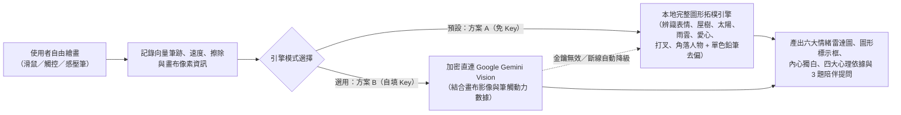

# 心畫室 MindCanvas v2.0 — 操作標準作業程序（SOP）

> **線上互動網頁（GitHub Pages）**：https://cpj0624.github.io/mindcanvas-drawing-psychology/  
> **GitHub 專案儲存庫**：https://github.com/cpj0624/mindcanvas-drawing-psychology  
> **Google Drive 專案資料夾**：`反重力 / 心畫室_MindCanvas_兒童心理學繪畫探索/`

---

## 一、系統雙引擎總覽與使用情境選擇

心畫室 v2.0 採用 **「圖形與表情優先（Shape-First）＋ A / B 雙引擎自動降級」** 架構，您可依當下需求自由切換：

| 比較面向 | 方案 A：本地圖形與表情引擎（預設） | 方案 B：Gemini 視覺深度模式（選用） |
| --- | --- | --- |
| **適用情境** | 一般日常測試、課堂體驗、單色鉛筆素描、重視 100% 離機隱私 | 複雜故事情境畫、特定動物／怪物、多人物互動關係、微細 HTP 細節 |
| **是否需要 API Key** | **不需要**（完全免費） | 需使用者自行填入個人免費 Gemini API Key（BYOK） |
| **資料隱私** | 畫作 100% 留在瀏覽器本地運算，不外傳 | 僅按下分析時將畫布 PNG 加密直連 Google 官方 API |
| **分析速度** | `< 0.1 秒` 即時完成 | 約 `2 – 5 秒` |

---

## 二、方案 A 標準操作流程（免設定・日常預設模式）

### 步驟 1：開啟網頁並確認引擎狀態
1. 使用任一現代瀏覽器（Chrome、Safari、Edge）開啟：https://cpj0624.github.io/mindcanvas-drawing-psychology/
2. 確認右上角狀態鈕顯示 **`本地圖形引擎 A`**（預設即為此模式）。

### 步驟 2：挑選畫具與自由繪畫
1. **選擇筆刷**：依手感選擇 `蠟筆`、`鉛筆`（單色素描推薦）、`水彩`、`麥克筆` 或 `橡皮擦`，並可切換 4 段粗細與 3 種畫紙底色。
2. **自由創作**：
   - 可直接使用預設**炭墨黑**作畫（系統具備「單色鉛筆去偏」，**不會**因為畫黑色就誤判負面情緒），或自由混用 16 色調色盤。
   - 若想先體驗系統如何區分圖形與顏色，可點擊右上角 **`心理範例畫作`**，試玩 **`黑筆笑臉與太陽（單色）`**、**`暖黃筆哭泣落淚臉`** 或 **`黑筆有門窗房屋（HTP）`**。
3. **復原與重做**：可用工具列按鈕或快捷鍵 `Ctrl + Z`／`Ctrl + Y`（系統會溫柔記錄修改次數作為 Koppitz 擦除參考）。

### 步驟 3：（選填）補充心情文字或元素標籤
- 在畫布下方輸入框，可請作畫者**為畫取名字或寫一句心裡話**（留空完全不影響分析）。
- 也可選擇性點選下方元素標籤（人物、房子、樹木、太陽、烏雲／下雨、風暴／怪獸、動物、抽象情緒線條）。

### 步驟 4：點擊「解析畫作心理狀態」並檢視報告
1. 點擊 **`解析畫作心理狀態`** 按鈕。
2. **畫布圖形辨識標示框**：系統若辨識出完整圖形（如 `微笑開朗臉孔`、`哭泣落淚臉孔`、`有門窗的完整房屋（HTP）`、`太陽與光芒`、`愛心符號`、`打叉否定標記（✕）`、`角落中的微小人物`），會在畫布上以柔和虛線框標示位置；可隨時點擊畫布右下角 **`隱藏／顯示圖形標示框`** 切換。
3. **閱讀右側報告**：
   - **頂部摘要卡**：查看主要與伴隨情緒、是否啟用「單色鉛筆去偏」、辨識到的完整圖形清單，以及**「這幅畫內心可能想表達的話」**。
   - **言畫對照觀察**：若寫下正向文字（如「我很開心沒事」）但圖形呈現明顯傷心／憤怒／焦慮張力，系統會跳出「可能的情緒掩飾」溫柔提示。
   - **六大情緒光譜**：檢視雷達圖與各項情緒強度指數。
   - **四大心理學依據分頁**：依序切換 `圖形象徵`、`構圖空間（九宮格熱力圖）`、`筆觸動力`、`色彩輔助`。
   - **溫柔陪伴提問**：參考底部 3 題開放式提問與自己或孩子對話。

### 步驟 5：保存畫作或重新繪製
- 若要留存圖片，點擊工具列右側 **下載圖示（儲存 PNG）**。
- 同一次瀏覽中分析的多幅作品會暫存於右下角 **`本次情緒畫作足跡`**，點縮圖可即時回顧比較；**重新整理或關閉分頁後所有畫作與紀錄皆自動清除**以保護隱私。

---

## 三、方案 B 進階操作 SOP（啟用 Gemini 視覺深度解讀・BYOK）

> [!IMPORTANT]
> 本網頁程式碼完全不含任何 API Key。此模式採 **BYOK（自備金鑰）** 設計，您輸入的金鑰**僅暫存於瀏覽器單一分頁的 `sessionStorage`**，關閉分頁即自動銷毀，絕不會傳送給 GitHub 或任何第三方伺服器。

### 步驟 1：免費取得個人 Google Gemini API Key（約 1 分鐘）
1. 前往 Google 官方 AI Studio：https://aistudio.google.com/apikey
2. 使用您的 Google 帳號登入。
3. 點擊 **`Create API key`** 建立一把免費金鑰並複製（格式為 `AIza...`）。

### 步驟 2：在心畫室安全啟用方案 B
1. 回到心畫室網頁，點擊右上角的 **`本地圖形引擎 A`** 按鈕開啟「心理分析引擎設定」視窗。
2. 點選 **`方案 B：Gemini 多模態視覺深度解讀（選用・BYOK）`**。
3. 在密碼輸入框貼上剛複製的 API Key（全程以 `••••••` 遮罩顯示，避免螢幕旁人或截圖看見）。
4. 視覺模型維持預設 **`gemini-2.5-flash`**（若遇流量限流可切換 `gemini-2.0-flash`）。
5. 點擊 **`儲存設定`**，確認右上角狀態鈕切換為綠燈 **`Gemini 視覺模式 B`**。

### 步驟 3：進行 AI 深度解讀與自動降級說明
1. 照常繪畫並點擊 **`解析畫作心理狀態`**，按鈕會顯示「Gemini 視覺分析中…」約 2–5 秒。
2. 報告會標記 **`Gemini 視覺深度模式 B`**，並列出 AI 在畫中辨識出的所有具體物體、表情細節與互動情境，同時融合方案 A 的客觀落筆速度、九宮格構圖與擦除次數。
3. **無縫自動降級**：若金鑰輸入錯誤、免費額度用盡或網路中斷，網頁會跳出簡短提示並**自動切換回方案 A 完成報告**，不會中斷使用。

### 步驟 4：使用完畢後安全清除金鑰（公用電腦必做）
1. 點擊右上角 **`Gemini 視覺模式 B`**。
2. 點擊視窗左下角 **`清除金鑰並切回本地`**（或直接關閉該瀏覽器分頁，系統即自動銷毀暫存金鑰）。

---

## 四、親子／教師／自我探索陪伴指引 SOP（藝術治療實務倫理）

依據 Cathy Malchiodi《Understanding Children's Drawings》核心原則，使用本工具陪伴兒童或進行情緒覺察時，請遵循以下「三步原則」：

1. **作畫前（建立無壓力安全感）**
   - 告知作畫者：「這不是美術課，沒有畫得好不好或像不像，想畫什麼線條、顏色或圖案都可以。」
   - 避免下指導棋（例如不要規定「畫一個開心的太陽」或「不要用黑色」）。
2. **作畫中（靜靜陪伴、不打斷、不搶先猜測）**
   - 讓作畫者自主決定停筆時機與擦除動作，不要在旁邊評論「怎麼畫得這麼亂／這麼小」。
3. **作畫後（先聽故事，再看報告，絕不貼診斷標籤）**
   - 先邀請對方用自己的話說說畫了什麼，並可輸入至「心裡話」欄位。
   - **把分析報告視為「溫柔的線索與對話起點」**，搭配報告底部的 **3 題開放式陪伴提問**開啟交流，切勿直接對孩子宣判「電腦說你很焦慮／很生氣」。
   - 若觀察到持續且嚴重的情緒困擾或自傷訊號，請尋求專業諮商心理師、臨床心理師或學校輔導室協助。

---

## 五、資安與版本維護檢查清單（管理者用）

| 檢查項目 | 標準規範與確認方式 |
| --- | --- |
| **零金鑰外洩檢查** | 公開 GitHub 儲存庫內**絕不可**出現任何 `AIza...`、`sk-...`、`.env` 或明文金鑰；API Key 僅允許由使用者於瀏覽器輸入框填入，並透過 `x-goog-api-key` Header 傳送（不放在 URL 查詢參數中）。 |
| **公用裝置隱私保護** | 畫作歷史僅存於當次記憶體，金鑰僅存於 `sessionStorage`；刷新或關閉分頁即全部歸零。 |
| **本地後端測試驗證** | 若在開發機修改後端程式碼，執行 `python3 -m unittest discover -s tests -v`，確認 13 項單元測試全數通過後再推送更新。 |
| **雲端資料同步規範** | 所有本專案產出檔案統一集中存放於 Google Drive `反重力/心畫室_MindCanvas_兒童心理學繪畫探索/` 資料夾，不放置散檔於根目錄。 |

---

## 六、常見問題排除（FAQ）

- **Q1：我只用預設黑筆畫了笑臉，為什麼不會被判成傷心或焦慮？**  
  A：v2.0 內建「單色鉛筆去偏」與「表情拓樸辨識」，偵測到全畫僅使用單一顏色時會自動降低色彩權重、歸零黑色負向扣分，並優先辨識圓臉中的上揚微笑弧線，因此會準確判為「愉悅與活力」。
- **Q2：為什麼畫布上沒有出現虛線圖形標示框？**  
  A：圖形標示框會在方案 A 辨識出特定完整結構（臉孔表情、房屋、太陽、雨雲、愛心、打叉、柵欄、角落人物）時自動顯示；若為純抽象線條塗鴉則不會顯示外框，仍會完整依筆觸動力、九宮格空間與色彩產出分析。
- **Q3：啟用方案 B 時顯示「Gemini API HTTP 400 / 403 / 429」怎麼辦？**  
  A：`400/403` 通常代表 API Key 複製不完整或尚未啟用，請回 Google AI Studio 確認金鑰；`429` 代表短時間呼叫過快達免費頻率上限，稍等 1 分鐘或切換 `gemini-2.0-flash` 即可（期間系統會自動降級使用方案 A，不受影響）。
- **Q4：網頁重新整理後剛才的畫作紀錄會不見嗎？**  
  A：會。為保護隱私，本系統預設不將個人畫作寫入硬碟或雲端資料庫；如需保存作品，請在刷新前點擊工具列「下載畫作 PNG」。
