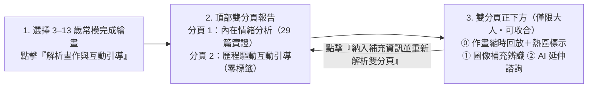

# 心畫室 MindCanvas v3.5 — 操作標準作業程序（SOP）

> **線上互動網頁（GitHub Pages）**：https://cpj0624.github.io/mindcanvas-drawing-psychology/  
> **GitHub 專案儲存庫**：https://github.com/cpj0624/mindcanvas-drawing-psychology  
> **Google Drive 專案資料夾**：`反重力 / 心畫室_MindCanvas_兒童心理學繪畫探索/`

---

## 一、系統核心定位、雙分頁與輔導員工具總覽（v3.5）

心畫室 MindCanvas v3.5 專為 **3–13 歲（青少年時期前）兒童**設計，核心目標是透過繪圖分析情緒線索並提供**開放式溝通引導**，讓孩子安全表達內心想法（**絕非單向臨床診斷**）。本版針對**平板觸控與筆電觸控板（無油漆桶功能）**全面調校去偏，並於 **方案 A（本地引擎）** 與 **方案 B（Gemini 視覺模式）** 同步導入 **8 大類別・29 篇國際心理學同儕審查期刊實證 ＋ 6 部受限經典架構（共 35 項來源）**：

- **分頁 1｜內在情緒分析**（給大人／助人者檢視）：六大情緒光譜、互動式三層判斷邏輯樹狀圖（含 3C 流行文化去偏、神經多樣性 ASD 護欄、雨中人 DAPR 保護物件與當代日常符號對照）、Pénzes 正向內在資源、四大實證子分頁與多元替代解釋。
- **分頁 2｜圖像互動引導（邊畫邊說）**（**零情緒標籤・可與孩子並肩共看**）：依據 Gross & Hayne (1998) 與 Driessnack (2005, `d = 0.95`) 設計，**結合真實作畫歷程熱區（重複描繪、反覆修改、首末筆順序與停頓轉折）**自動產出貼近真實畫畫行為的開放式提問，並隱藏所有情緒分數、雷達圖與下方輔導員區。
- **雙分頁下方｜輔導人員專屬「作畫縮時回放檢視」與 AI 諮詢重算區**（**僅限輔導人員／大人・繪畫與分析完成後使用**）：
  - **⓪ 作畫歷程縮時回放檢視**：獨立預覽畫布（不覆蓋主畫布），支援播放／暫停、重播、`1x / 2x / 4x` 倍速、進度條拖曳與「標示重複描繪／修改熱區」，協助輔導員一眼看懂被蓋掉的底層圖案與猶豫位置。
  - **① 協助圖像辨識與訪談回填** ＋ **② AI 延伸諮詢對話（純文字・無麥克風）**：補充模糊畫面元素與訪談反應並一鍵重新解析雙分頁。

| 比較面向 | 方案 A：本地實證與介面筆觸引擎（預設） | 方案 B：Gemini 實證視覺模式（選用） |
| --- | --- | --- |
| **適用情境** | 平板／觸控板日常陪伴、課堂體驗、單色鉛筆素描、重視 100% 離機隱私 | 複雜故事情境畫、動漫／遊戲角色細節、多人物互動、開放式多輪 AI 督導諮詢 |
| **實證依據** | 完整內建 8 大類別 29 篇國際期刊實證演算法＋6 部受限經典架構 | Prompt 完整嵌入同一套 29 篇實證、3C／ASD 護欄與 `processHighlights` 歷程亮點 |
| **輔導員回放與重算** | 支援縮時回放＋熱區疊框＋補充辨識重算＋免金鑰本地諮詢顧問 | 支援縮時回放＋高優先人工脈絡視覺重算＋檢視靜態畫作之多輪多模態 AI 顧問 |
| **是否需要 API Key** | **不需要**（完全免費） | 需使用者自行填入個人免費 Gemini API Key（BYOK） |
| **資料隱私** | 畫作、回放軌跡與諮詢 100% 留在瀏覽器本地記憶體，不外傳 | 僅按下解析或送出提問時加密直連 Google 官方 API，零第三方留存 |
| **分析速度** | `< 0.1 秒` 即時完成 | 約 `2 – 5 秒` |

---

## 二、3C 數位裝置感測分流與經典理論限縮說明（v3.5）

依據 Price et al. (2015) 與 Mohd Shukri (2014) 實證，系統會自動偵測裝置並防止將數位介面操作特性誤判為情緒困擾：

| 裝置類型 | 畫布右下角顯示 | v3.5 筆壓與動態操作處理方式 |
| --- | --- | --- |
| **平板／手機手指觸控** | `觸控接觸面積感測` | **筆壓情緒權重歸零（`0.00`）**；多段短筆畫、手滑復原、疊色塗抹與停頓之情緒加權全面調降約 **55%–62%**，主要轉化為輔導員縮時回放與分頁 2 對話提問。 |
| **一般滑鼠／筆電觸控板** | `滑鼠介面＋擬真筆壓` | **筆壓情緒權重歸零（`0.00`）**，捨棄瀏覽器恆定 `0.5` 假筆壓；動態復原／疊畫／微震顫權重全面調降 55%–62%。 |
| **電繪板／硬體感壓筆（未來支援）** | `感壓筆真壓感測` | 僅在偵測到真實硬體壓感變化（`pressure` 標準差 > `0.035`）時，啟用**低權重動作張力參考（`0.07`）**。 |

> [!NOTE]
> **經典理論限縮原則**：v3.5 確保「完整圖像內容（表情、情境、保護物）與多維收斂門檻」永遠優先於經典投射——**Pulver (1931/1953)** 左右／上下空間心理推論全面移除（僅保留客觀幾何位置描述）；**Koppitz (1968)** 於 3–6 歲完全停用部位省略扣分（`×0.00`）；**Buck (1948)** 房屋門窗僅作結構分類與開放提問切入點，不作僵化一對一扣分。

---

## 三、方案 A 標準操作流程（免設定・日常預設模式）

### 步驟 1：開啟網頁並確認引擎狀態
1. 使用任一現代瀏覽器（Chrome、Safari、Edge）開啟：https://cpj0624.github.io/mindcanvas-drawing-psychology/
2. 確認右上角狀態鈕顯示 **`本地實證引擎 A`**（預設即為此模式）。

### 步驟 2：選擇 3–13 歲年齡常模與自由繪畫
1. **選擇筆刷與粗細**：支援 `蠟筆`、`鉛筆`（單色素描推薦）、`水彩`、`麥克筆` 與 `橡皮擦`（專為手繪體驗設計，無油漆桶功能）。
2. **選擇 3–13 歲年齡常模（畫布下方右側）**：
   - **`3–6 歲（學齡前）`**：完全停用 Koppitz 部位省略扣分（`×0.00`），提醒排除平板手指誤觸與多段短筆畫。
   - **`7–10 歲（國小中低年級）`**：3C 動漫／遊戲接觸高峰期；偵測怪物、尖牙、武器等角色時自動降權負向張力並優先提供「媒體來源檢核提問」（Ivashkevich, 2009）。
   - **`11–13 歲（國小高年級／青春期前）`**：針對極簡火柴人、頻繁復原或暗黑酷炫畫風，優先提供「寫實前期怕畫不像／同儕審美」溫和替代解釋。
   - **`未指定（3–13 歲通用）`**：套用通用圖像優先與數位降權常模。
3. **自由創作或試玩範例**：可直接作畫，或點右上角 **`心理範例畫作`** 體驗 9 組期刊實證測試範例。

### 步驟 3：點擊「解析畫作與互動引導」並自由切換雙分頁
- **分頁 1｜內在情緒分析**：檢視六大情緒光譜、**三層判斷邏輯樹狀圖**、Pénzes 正向內在資源、Thomas & Jolley 多元替代提醒；若畫面呈現高度重複幾何、機械／物件細節或情緒符號偏少，卡片區與樹狀圖分支 ⑤ 會自動浮現 **「神經多樣性（ASD）評估護欄提醒」**（Papangelo et al., 2020; Kotroni et al., 2018）。
- **分頁 2｜圖像互動引導（邊畫邊說）**：自動隱藏情緒分數、雷達圖與歷史足跡，並**自動暫停與收合下方輔導員縮時回放與諮詢區**。第 1 步與第 3 步將優先顯示依據真實作畫歷程熱區生成的開放式提問（如重複疊畫區域、修改次數最多處、起筆到末筆順序、停頓轉折）。

### 步驟 4：作畫與訪談後 — 使用「輔導員縮時回放檢視」與 AI 諮詢重算區
> [!TIP]
> 本區僅限輔導人員、教師或家長於**作畫與初次解析完成後**使用。若先前切換過分頁 2，點擊右上角 **`展開諮詢區`** 即可開啟。

1. **⓪ 作畫歷程縮時回放檢視（輔導員專用）**：
   - 點擊 **`▶ 播放回放`** 或 **`↺ 重播`**，可於獨立預覽畫布依原始落筆順序還原作畫過程（完全不覆蓋左側主畫布）。
   - 支援 **`1x / 2x / 4x`** 倍速切換與進度條自由拖曳（即時顯示 `第 N / 總筆數 筆`）。
   - 勾選 **`標示重複描繪／修改熱區`**，畫布會以柔和半透明框標示出重複疊畫最多次（橘框）與反覆復原／擦除（紫框）的區域，協助一眼看懂被覆蓋的底層圖案與猶豫點。
2. **① 協助圖像辨識與後續訪談資訊回填**：
   - 輸入孩子親口說明的畫中元素（含現代日常符號如 `戴耳機的自己`、`桌上考卷`、`棉被裡的秘密基地`、`遊戲裡的怪獸`）並按 **`加入元素`**，補充訪談紀錄後點 **`納入補充資訊並重新解析雙分頁`**。
3. **② 輔導人員 AI 延伸諮詢對話（純文字）**：
   - 支援快捷提問（含 **`平板常復原／短筆畫會誤判嗎？`**、補充模糊內容、分數依據、孩子沉默接話、整理重算）。
   - 若對話或紀錄涉及自傷、受暴等高風險線索，系統立即攔截並顯示紅色 **「高風險安全與專業轉介提醒」**（`1925`、`1995`、`113`、`110/119`）。

### 步驟 5：結束個案與隱私清理
- 點擊工具列右側 **下載圖示（儲存 PNG）** 可存檔圖片；**點擊「清空畫布」或關閉分頁後，所有畫作、縮時回放軌跡、修改熱區座標、孩子原話與輔導員對話紀錄皆立即從瀏覽器記憶體徹底銷毀**。

---

## 四、方案 B 進階操作 SOP（啟用 Gemini 實證視覺與多輪 AI 顧問・BYOK）

> [!IMPORTANT]
> 本網頁程式碼完全不含任何 API Key。此模式採 **BYOK（自備金鑰）** 設計，金鑰**僅暫存於單一分頁 `sessionStorage`**，關閉分頁即自動銷毀。

1. 前往 Google 官方 AI Studio（https://aistudio.google.com/apikey ）建立免費金鑰（`AIza...`）。
2. 在公開瀏覽器開啟 https://cpj0624.github.io/mindcanvas-drawing-psychology/ 。
3. 點右上角 **`本地實證引擎 A`** → 選 **`方案 B：Gemini 實證視覺深度解讀（選用・BYOK）`** → 貼上 API Key → 維持 **`自動偵測金鑰最新可用模型（推薦）`** → 按 **`測試金鑰並偵測可用模型`** → 成功後點 **`儲存設定`**。
4. 啟用後，系統會將靜態畫布快照、`processHighlights` 作畫歷程亮點、3–13 歲年齡常模與 29 篇國際實證準則傳送至 Google 官方 API 深度解讀；若連線異常或超限會自動無縫降級回方案 A。
5. **公用電腦使用完畢必做**：點擊 **`Gemini 實證模式 B`** → **`清除金鑰並切回本地`**（或關閉該分頁）。

---

## 五、資安與零資訊外洩檢查清單（管理者用）

| 檢查項目 | 實作機制與資安驗證結果 |
| --- | --- |
| **零金鑰外洩與傳輸保護** | 原始碼與 Git 歷史絕無任何明文金鑰；金鑰僅存單一分頁 `sessionStorage`（零 `localStorage`／Cookie），嚴格僅經 `x-goog-api-key` Header 直連 Google 官方 API。 |
| **嚴格 CSP 與網路白名單** | `Content-Security-Policy` 僅允許 `connect-src 'self' https://generativelanguage.googleapis.com`；`object-src 'none'`、`form-action 'none'`、`Referrer-Policy: no-referrer`；零第三方追蹤器。 |
| **極簡權限與零留存** | 後端強制 `Permissions-Policy: camera=(), microphone=(), geolocation=()` 與 `Cache-Control: no-store`；全站不要求麥克風或相機權限；回放軌跡、熱區與諮詢紀錄於清空畫布或 `beforeunload` 即刻清空。 |
| **XSS 與 Prompt Injection 防護** | 所有對話氣泡、熱區文字與 AI 回覆 100% 採 `.textContent`、`escapeHtml()`、`safeCssHex()`、`safeAiText()` 淨化；後端 Pydantic 強制驗證所有 `processHighlights` 與文字上限。 |
| **自動化測試與雲端同步** | 執行 `python3 -m unittest discover -s tests -v` 確認 **36 項單元測試**全數通過，並通過前端 Node.js VM 安全與 parity 檢測；所有檔案集中原地更新於 Google Drive `反重力/心畫室_MindCanvas_兒童心理學繪畫探索/`。 |

---

## 六、常見問題排除（FAQ）

- **Q1：孩子在平板上常常把長線拆成很多短筆畫，又一直手滑按復原，會不會被判成高焦慮？**  
  A：不會！v3.5 依據 Price et al. (2015) 與 Mohd Shukri (2014) 實證，已將復原、短段筆畫、疊畫、微震顫與停頓的情緒權重全面調降 55%–62%，並停用手指／觸控板筆壓推論，改將這些軌跡提供給輔導員做縮時回放觀察與開放式提問。
- **Q2：縮時回放畫布會不會覆蓋孩子正在畫的主畫布，或不小心被孩子看到？**  
  A：不會！縮時回放使用完全獨立的預覽畫布且僅置於輔導員諮詢區內；一旦切換到分頁 2（陪孩子共看模式），系統會自動暫停回放並收合整個輔導員諮詢區。
- **Q3：孩子畫了滿嘴尖牙的怪獸或拿武器的角色，就代表有攻擊性嗎？**  
  A：不一定！依 Ivashkevich (2009) 研究，7–10 歲兒童常臨摹動漫、YouTube 影片或電玩角色。系統已自動調降此類線索的負向張力，並在分頁 2 優先產出「它是你自己想出來的，還是你在影片、漫畫或遊戲裡看過的呢？」協助先釐清來源。
- **Q4：為什麼啟用方案 B 時出現 HTTP 400 / 403 / 404 / 429？**  
  A：`400/401/403` 請回 Google AI Studio 確認金鑰權限；`404` 請切換為「自動偵測金鑰最新可用模型（推薦）」；`429` 代表免費方案短時間呼叫過快，稍等 1 分鐘即可（期間自動降級回方案 A）。
