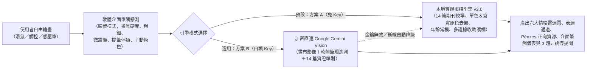

# 心畫室 MindCanvas v3.0 — 操作標準作業程序（SOP）

> **線上互動網頁（GitHub Pages）**：https://cpj0624.github.io/mindcanvas-drawing-psychology/  
> **GitHub 專案儲存庫**：https://github.com/cpj0624/mindcanvas-drawing-psychology  
> **Google Drive 專案資料夾**：`反重力 / 心畫室_MindCanvas_兒童心理學繪畫探索/`

---

## 一、系統雙引擎總覽與 v3.0 國際實證架構

心畫室 v3.0 同步於 **方案 A（本地引擎）** 與 **方案 B（Gemini 視覺模式）** 導入 **14 篇國際心理學同儕審查期刊實證研究**及**軟體繪畫介面筆觸感測機制**：

| 比較面向 | 方案 A：本地實證與介面筆觸引擎（預設） | 方案 B：Gemini 實證視覺模式（選用） |
| --- | --- | --- |
| **適用情境** | 一般日常測試、課堂體驗、單色鉛筆素描、重視 100% 離機隱私 | 複雜故事情境畫、特定動物／怪物、多人物互動關係、細微敘事細節 |
| **期刊實證依據** | 完整內建 14 篇國際期刊實證演算法與多證據護欄 | Prompt 完整嵌入同一套 14 篇實證準則＋融合軟體介面筆觸遙測 |
| **是否需要 API Key** | **不需要**（完全免費） | 需使用者自行填入個人免費 Gemini API Key（BYOK） |
| **資料隱私** | 畫作 100% 留在瀏覽器本地運算，不外傳 | 僅按下分析時將畫布 PNG 與客觀行為數據加密直連 Google 官方 API |
| **分析速度** | `< 0.1 秒` 即時完成 | 約 `2 – 5 秒` |

---

## 二、軟體繪畫介面筆觸感測運作說明

系統會自動偵測您的繪畫裝置，並結合「硬體 Pointer Events」與「軟體介面主動設定」判斷筆觸：

| 裝置類型 | 畫布右下角顯示 | 系統判斷筆觸力道與張力的方式 |
| --- | --- | --- |
| **感壓觸控筆（Apple Pencil / Wacom / Surface Pen）** | `感壓筆真壓感測` | 讀取硬體真實壓力 `pressure`（0–1）與筆身傾斜角 `tiltX / tiltY`，搭配畫具硬度與粗細。 |
| **平板／手機手指觸控** | `觸控接觸面積感測` | 讀取手指接觸面寬度 `width`、劃動速度、畫具硬度與重疊塗抹密度。 |
| **一般滑鼠／筆電觸控板** | `滑鼠介面＋擬真筆壓` | **自動捨棄滑鼠恆定 0.5 假筆壓**，改以**畫具硬度（麥克筆＞蠟筆＞鉛筆＞水彩）× 筆刷粗細 × 劃速 × 重疊塗抹**計算等效筆力，並加上高頻採樣 `getCoalescedEvents` 的**線條微震顫（Jitter）**與**提筆停頓佔比**。 |

- **`擬真筆壓` 按鈕（工具列預設開啟）**：使用滑鼠繪畫時，放慢運筆筆畫會較厚實、快速揮動則呈現自然收細；若想使用固定等寬線條，可隨時點擊工具列的 **`擬真筆壓`** 關閉（不影響底層真實裝置判別）。
- **主動介面操作紀錄**：系統會區分「從頭到尾使用預設黑筆未換色（`換色 0 次`）」與「刻意切換畫具、顏色與粗細」，強化單色去偏準確度。

---

## 三、方案 A 標準操作流程（免設定・日常預設模式）

### 步驟 1：開啟網頁並確認引擎狀態
1. 使用任一現代瀏覽器（Chrome、Safari、Edge）開啟：https://cpj0624.github.io/mindcanvas-drawing-psychology/
2. 確認右上角狀態鈕顯示 **`本地實證引擎 A`**（預設即為此模式）。

### 步驟 2：挑選畫具、年齡常模與自由繪畫
1. **選擇筆刷與擬真筆壓**：可選擇 `蠟筆`、`鉛筆`（單色素描推薦）、`水彩`、`麥克筆` 或 `橡皮擦`，切換 4 段粗細、3 種畫紙底色與 `擬真筆壓`。
2. **選填年齡常模（畫布下方右側）**：可選 `未指定（通用）`、`3–6 歲（學齡前）`、`7–10 歲（國小中低）`、`11 歲以上（高年級／成人）`。若選 `3–6 歲`，系統會依 Picard & Gauthier (2012) 自動降低「省略嘴巴／細節簡略」的負向權重。
3. **自由創作或試玩實證範例**：
   - 可直接以預設炭墨黑作畫（自動啟動單色去偏），或畫出藍天、綠草與暖陽（自動啟動 Crawford 2012「寫實原色去偏」，不會因藍色誤判悲傷）。
   - 點擊右上角 **`心理範例畫作`** 可一鍵體驗 `黑筆笑臉與太陽（單色）`、`藍天綠地暖陽（寫實原色）`、`暖黃筆哭泣落淚臉` 等範例。

### 步驟 3：（選填）「邊畫邊說」補充心裡話或元素標籤
- 依 Gross & Hayne (1998) 實驗，讓創作者為畫取名字或寫一句心裡話能讓真實情緒表達更完整（留空完全不影響分析）。

### 步驟 4：點擊「解析畫作心理狀態」並閱讀 v3.0 報告
1. **頂部摘要卡與實證標籤**：
   - 顯示**多維證據收斂等級**（`高收斂`／`中度收斂`／`低線索`）：若僅畫 1–2 筆簡單線條，系統會依 Joiner (1996) 與 Catte & Cox (1999) 自動將分數上限壓在 `66` 分以防過度解讀。
   - 顯示是否觸發 **`單色鉛筆去偏`**、**`寫實原色去偏`** 與啟用的**年齡常模**，以及偵測到的**表達通道**（字面表情／情境隱喻／抽象形式）。
2. **形式結構與內在正向資源卡（Pénzes, 2020）＋多元詮釋提醒（Thomas & Jolley, 1998）**：
   - 在呈現情緒傾向的同時，顯性指出創作者展現的心理彈性、表達勇氣或自我整理資源，並提供非情緒成因的溫和替代可能。
3. **四大證據分頁**：切換 `圖形象徵`、`構圖空間`、**`介面筆觸`**（含裝置感測模式標籤、等效筆力、微震顫、提筆停頓佔比等 6 項指標）與 `色彩輔助`。
4. **14 篇期刊依據**：點擊右上角 **`14 篇期刊依據`** 可隨時查閱所有導入文獻的作者、期刊名稱與 DOI。

### 步驟 5：保存畫作或重新繪製
- 點擊工具列右側 **下載圖示（儲存 PNG）** 可存檔圖片；**重新整理或關閉分頁後所有畫作與紀錄皆自動清除**以保護隱私。

---

## 四、方案 B 進階操作 SOP（啟用 Gemini 實證視覺解讀・BYOK）

> [!IMPORTANT]
> 本網頁程式碼完全不含任何 API Key。此模式採 **BYOK（自備金鑰）** 設計，您輸入的金鑰**僅暫存於瀏覽器單一分頁的 `sessionStorage`**，關閉分頁即自動銷毀，絕不會傳送給 GitHub 或任何第三方伺服器。

### 步驟 1：免費取得個人 Google Gemini API Key（約 1 分鐘）
1. 前往 Google 官方 AI Studio：https://aistudio.google.com/apikey
2. 使用 Google 帳號登入，點擊 **`Create API key`** 建立免費金鑰並複製（格式為 `AIza...`）。

### 步驟 2：在公開瀏覽器安全啟用方案 B
1. **請務必在一般瀏覽器開啟公開 GitHub Pages 網址**（https://cpj0624.github.io/mindcanvas-drawing-psychology/ ）——對話內建預覽沙盒會封鎖外部 API 連線。
2. 點擊右上角 **`本地實證引擎 A`** → 選擇 **`方案 B：Gemini 實證視覺深度解讀（選用・BYOK）`** → 貼上 API Key。
3. 視覺模型維持 **`自動偵測金鑰最新可用模型（推薦）`**，點擊 **`測試金鑰並偵測可用模型`** 確認綠框成功後按下 **`儲存設定`**。

### 步驟 3：AI 深度解讀與自動降級
- 方案 B 會將畫布影像連同您的**軟體介面筆觸遙測、年齡常模與 14 篇實證準則**一併交由 Gemini 綜合判讀，輸出結構化的表達通道、正向內在資源、替代解釋與非誘導提問。
- 若金鑰失效、頻率超限或斷線，將自動無縫降級為方案 A。

### 步驟 4：使用完畢清除金鑰（公用電腦必做）
- 點擊右上角 **`Gemini 實證模式 B`** → 按下左下角 **`清除金鑰並切回本地`**（或直接關閉該分頁）。

---

## 五、親子／教師「邊畫邊說」陪伴指引 SOP（Gross & Hayne 1998; Malchiodi 1998）

1. **作畫前（建立安全感）**：強調「沒有畫得像不像或對不對，想畫什麼都可以」，不指導用色或主題。
2. **作畫中（觀察但不打斷）**：不對塗改、畫小或選色下評語，讓創作者自主決定節奏。
3. **作畫後（非誘導式開放提問）**：
   - 依 Gross & Hayne (1998) 實證，優先問「可以跟我說說畫裡發生了什麼事嗎？」等開放問題，切勿用誘導問句（如「你是不是在學校被罵才畫黑雲？」）。
   - 先肯定報告中的 **Pénzes 正向內在資源**，再把情緒傾向當成溫柔聊天的起點，**絕不貼臨床診斷標籤**。
   - 若觀察到持續且嚴重的情緒困擾或自傷風險，請聯繫專業諮商／臨床心理師或學校輔導室。

---

## 六、資安與版本維護檢查清單（管理者用）

| 檢查項目 | 標準規範與確認方式 |
| --- | --- |
| **零金鑰外洩檢查** | 公開 GitHub 儲存庫及歷史 commit 絕不可包含 `AIza...`、`sk-...`、`.env` 或明文金鑰；金鑰僅透過 `x-goog-api-key` Header 傳送。 |
| **DOM XSS 與輸入防呆** | 所有動態報告／AI 文字均經 `escapeHtml()`、`safeCssHex()`、`safeAiText()` 淨化；後端 Pydantic 強制禁止 `NaN/Inf` 並限制點數上限（50,000 點）。 |
| **自動化單元測試** | 執行 `python3 -m unittest discover -s tests -v`，確認 **22 項單元測試**全數通過後再發布。 |
| **雲端同步規範** | 所有專案交付檔統一集中更新於 Google Drive `反重力/心畫室_MindCanvas_兒童心理學繪畫探索/`，不置散檔於根目錄。 |

---

## 七、常見問題排除（FAQ）

- **Q1：用一般滑鼠畫畫沒有真實筆壓，系統怎麼判斷筆觸輕重？**  
  A：系統會自動偵測 `pointerType = mouse`，捨棄滑鼠恆定 `0.5` 的假筆壓，改用您選的畫具硬度（麥克筆＞蠟筆＞鉛筆＞水彩）、筆刷粗細、劃動速度、重疊塗抹密度、線條微震顫與提筆停頓佔比綜合推估，並在報告「介面筆觸」分頁誠實標示為「滑鼠／觸控板介面推估」。
- **Q2：我畫了藍天、綠地和黃太陽，為什麼不會因為大面積藍色而被判悲傷？**  
  A：v3.0 依據 Crawford 等人（2012）寫實原色實驗內建「寫實原色去偏」，偵測到藍＋綠／暖黃自然風景組合時會自動降權藍色的負向悲傷分數並顯示 `寫實原色去偏` 標籤。
- **Q3：我只畫了一條線，為什麼分數最高只有 66 分？**  
  A：依 Joiner (1996) 與 Catte & Cox (1999) 實證，單一線條或單一特徵不可直接推論情緒困擾；v3.0 在偵測到「低線索」時會主動調降極端分數上限，避免誤導使用者。
- **Q4：啟用方案 B 時出現 HTTP 400 / 403 / 404 / 429 怎麼辦？**  
  A：`400/401/403` 請回 Google AI Studio 確認金鑰與權限；`404` 請切換為「自動偵測金鑰最新可用模型（推薦）」；`429` 代表免費方案短時間呼叫過快，稍等 1 分鐘即可（期間自動降級回方案 A）。
